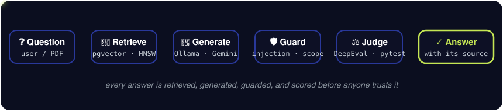

<p align="center">
  
</p>

<p align="center">
  
</p>

<p align="center">
  <a href="https://sujitspark.in"></a>
  <a href="https://www.linkedin.com/in/sujit-shiravle"></a>
  <a href="mailto:shiravlesujit@gmail.com"></a>
  
</p>

<p align="center"><i>Final-year B.Tech AI &amp; Data Science · Navi Mumbai · I build LLM apps, then I try to break them.</i></p>

---

## 🧪 How I build AI

<p align="center">
  
</p>

<details>
<summary><b>🔬 My 5-step playbook for testing an LLM app</b> <i>(click to open)</i></summary>
<br>

1. **Write the exam first.** A golden dataset with real answers, questions the bot *must refuse*, and attacks.
2. **Test the real thing.** Evals hit the live API, not a copy of the pipeline.
3. **Trust, but calibrate.** Cheap deterministic checks gate a release; LLM-as-judge scores are a signal I check against human review.
4. **Attack with phrasings I didn't train on.** If the guardrail only stops the attacks I wrote, it isn't a guardrail.
5. **Every bug becomes a regression test**, and CI runs them on every push.

That's how KnowledgeBot went from 67% to 100% citation accuracy, and how a benchmark caught JudicAI's risk model reading its own answer key.
</details>

---

## 🚀 Things I've built

<table>
<tr>
<td width="50%" valign="top">

### 🛡️ [KnowledgeBot](https://github.com/SujitSpark/knowledgebot)
Chat with your PDFs, **100% offline**.
`React Native` `PostGraphile` `pgvector` `Ollama`

🧪 DeepEval + promptfoo eval and red-team suite · guardrails · CI

</td>
<td width="50%" valign="top">

### ⚖️ [JudicAI](https://github.com/SujitSpark/JudicAi)
Multi-agent triage for court backlogs.
`LangGraph` `FastAPI` `React` `XGBoost` `Gemini`

📊 1,200-case benchmark · leakage bug found and fixed · AUC 0.60 → 0.65

</td>
</tr>
<tr>
<td width="50%" valign="top">

### 📈 [PriceWar](https://github.com/SujitSpark/price_war)
Game theory for food-delivery price wars: Nash, Bertrand, Bayesian and repeated games.
`FastAPI` `React` `TypeScript`

</td>
<td width="50%" valign="top">

### 💬 [Emotion-Aware Dialogue](https://github.com/SujitSpark/NLP)
Detects 27 fine-grained emotions, picks an empathy strategy, then lets an LLM reply. *Team project.*
`PyTorch` `Transformers` `Gradio`

</td>
</tr>
</table>

---

## 📜 `git log --oneline --career`

```diff
+ 2026-11  feat(evals): red-team suite for KnowledgeBot, 3 bugs caught, 3 fixed
+ 2026-07  docs(research): co-authored IEEE I2ITCON 2026 paper on an AutoML learning platform
+ 2026-06  feat: KnowledgeBot, an offline RAG assistant (pgvector + Ollama)
+ 2026-03  ctf: 4th place, Technovate'26 Capture The Flag
+ 2026-02  feat: JudicAI, multi-agent judicial triage (LangGraph + FastAPI)
@ 2025-10  job: SDE Intern @ Infidhi Ventures (React Native + GraphQL/PostgreSQL)
@ 2025-08  job: Junior Intern @ Infidhi Ventures (PERN stack + RAG over internal docs)
@ 2024-12  job: Web Developer Intern @ Nexon Logistics (Firebase event booking)
+ 2024-06  feat: SIES GST Student Portal, used by 4,000+ students, 12,000+ forms
+ 2024     win: 2nd Runner Up, SustainX 2024
  2023-06  init: B.Tech AI & Data Science @ SIES GST
```

---

## 🧰 Toolbox

<p align="center">
  
</p>

<p align="center">
  
  
  
  
  
  
  
  
  
</p>

---

<p align="center">
  <picture>
    <source media="(prefers-color-scheme: dark)" srcset="https://raw.githubusercontent.com/SujitSpark/Sujitspark/output/github-snake-dark.svg" />
    
  </picture>
</p>

<p align="center"><sub>⚡ Ask me about: why an R² of 1.00 is a red flag · making a chatbot say "PWNED" · RAG that runs with no internet</sub></p>

<p align="center">
  
</p>
